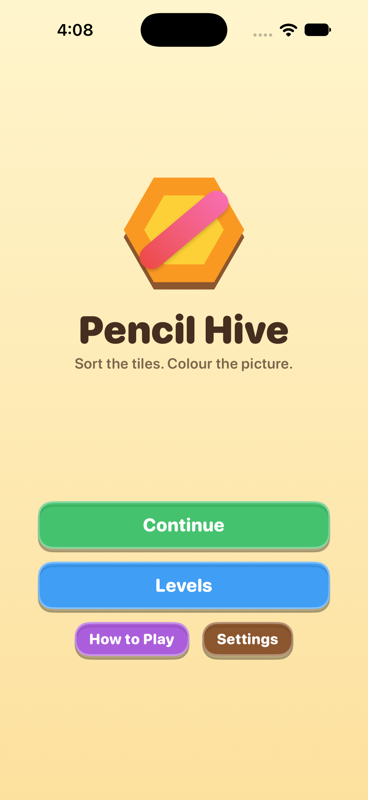
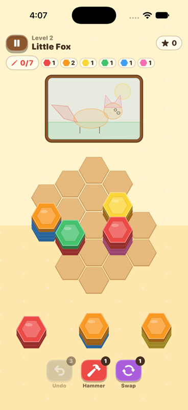
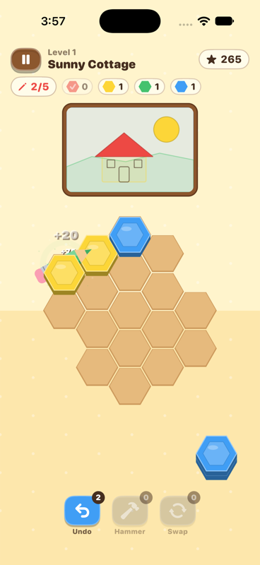
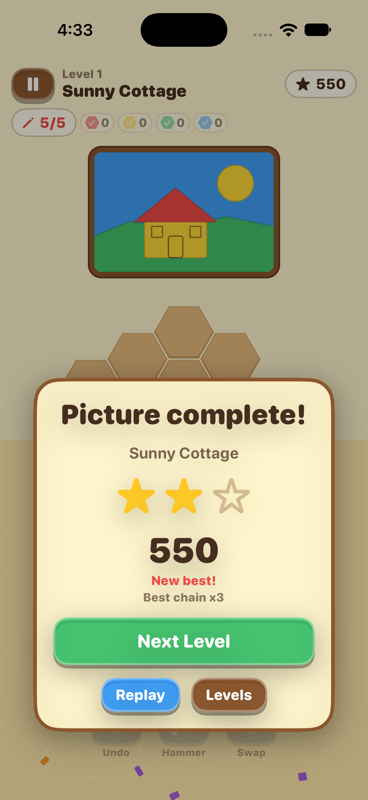

# Pencil Hive

An offline iPhone puzzle game: drag stacks of hex tiles onto a honeycomb board, let matching colours
flow together, and turn full stacks into **coloured pencils** that fly across the screen and colour in
an illustration. Finish the picture to win.

Original game, art, sounds and code. It is *inspired by* the "hex sort" genre (and by the App Store
game Pencil Sort: Color Sorting) but shares no code or assets with any existing game.

- **Swift + SwiftUI** for menus, HUD, boosters and overlays
- **SpriteKit** for the board, drag and drop, animation and particles
- Native Xcode project, iPhone only, portrait, **iOS 16+**
- No backend, accounts, ads, in-app purchases or network access

## Run it on the iPhone Simulator

You need a Mac with **Xcode 16 or newer** (built and checked with Xcode 27.1).

1. Open the project:

   ```bash
   open PencilHive.xcodeproj
   ```

2. If Xcode asks, accept the license (`sudo xcodebuild -license accept`) and install an iOS Simulator
   runtime (**Xcode > Settings > Components**, or `xcodebuild -downloadPlatform iOS`).
3. In the toolbar pick the **PencilHive** scheme and any iPhone simulator, e.g. *iPhone 17*.
4. Press **Run** (⌘R). The app launches on the title screen. Tap **Play**.

From a terminal, build and launch the app, then view the booted phone in Device Hub (Xcode 27)
or Simulator (earlier Xcode versions):

```bash
# Run from the root of your pencil-hive checkout.
xcrun simctl list devices available            # pick a device name, e.g. "iPhone 17"
xcodebuild -project PencilHive.xcodeproj -scheme PencilHive \
  -destination 'platform=iOS Simulator,name=iPhone 17' \
  -derivedDataPath build build
xcrun simctl boot "iPhone 17" || true
xcrun simctl install booted build/Build/Products/Debug-iphonesimulator/PencilHive.app
xcrun simctl launch booted dev.pencilhive.PencilHive
```

To run on a real iPhone, select the *PencilHive* target > *Signing & Capabilities*, choose your team and
change the bundle identifier (`dev.pencilhive.PencilHive`) to one you own.

## Run the tests

Unit tests use [Swift Testing](https://developer.apple.com/documentation/testing) (Xcode 16+).

```bash
# In Xcode: Product > Test (⌘U) with the PencilHive scheme, or:
xcodebuild -project PencilHive.xcodeproj -scheme PencilHive \
  -destination 'platform=iOS Simulator,name=iPhone 17' test

# The rules engine is platform independent, so it also tests on the Mac with no simulator:
swift test
```

123 Mac tests and 144 iOS tests cover placement, hex adjacency and layout, merging, cascades, pencil creation, goals,
win/fail rules, boosters, save/restore (including saves that no longer fit a level), the height cap,
the early win save, level validation, and a solver that proves every shipped
level can be won without boosters.

## How to play

1. Drag a stack from the **tray** to any empty **cell**. Legal cells glow while you drag.
2. When stacks touch, the placed stack pulls the **top run of its colour** from each neighbour whose
   top tile matches. A neighbour that is left showing a new colour can match *its* neighbours in turn, so
   chains (cascades) happen automatically and score more.
3. When one colour makes a run of **N tiles** (shown per level; 3 to 4 in the shipped levels) the run is
   cleared into a **pencil**. The pencil flies to the meter above the board and fills the next region of that colour behind the scenes.
   The tiles below it are revealed and can match again.
4. Fill every region to reveal the finished picture on the reward screen and add it to the Gallery. Each level has up to three stars: one for finishing the picture, one for its bonus goal (shown on the pause card: a chain depth, a number of stacks, or a score), and one for finishing without spending a booster. Level 3 shows a move counter; levels can set a `moveLimit`, and unused moves score a bonus.
5. **Boosters:** *Undo* takes back the last action, *Hammer* smashes any stack, *Swap* sends the tray
   to the back of the queue and deals new stacks. The game also fails if the board fills up with stacks
   still waiting, or you run out of stacks or moves; *Undo* can rescue a failed level.

Progress, stars, unlocked levels, settings and the level you are in the middle of are saved locally
(`Application Support/PencilHive/save.json`). A win is written the moment the winning move is
accepted, not when the result card appears. A game in progress that no longer fits its level is
dropped without touching progress, and a save file that cannot be read is copied aside as
`save.unreadable-<time>.json` (earlier copies are never overwritten).

## Accessibility

- **Not colour alone:** every colour has its own shape (circle, triangle, square, diamond, star, plus, cross, ring)
  printed on its tiles and goal chips. Turn it on in Settings > Tile symbols; it is always on when iOS
  *Differentiate Without Color* is on.
- **VoiceOver:** the HUD, boosters, level cards and result cards are labelled. The SpriteKit board publishes its
  own elements: double tap a tray stack to pick it up, then double tap an empty cell to place it (no dragging
  needed). Moves, pencils, chains and the result are announced.
- **Text size:** menus and cards follow Dynamic Type up to the second accessibility size and scroll when they get tall.
  The in-game HUD and booster bar have a fixed height the board is laid out around, so their text stops growing
  at *xLarge*; VoiceOver reads their values in full.
- **Reduce Motion:** no screen shake, confetti, bursts, rings or pulsing highlights, and plain fades instead of slides and scales.

## Project layout

```
PencilHive.xcodeproj/        App target PencilHive + unit-test target PencilHiveTests
Package.swift                Builds only Core, so `swift test` works without a simulator
PencilHive/
  Core/                      Deterministic rules. Foundation + CoreGraphics only, no UIKit/SpriteKit
    HexCoord, HexBoard, HexLayout      Axial coordinates, board storage, hex <-> point maths
    TileColor, TileStack               Tiles and stacks (bottom -> top)
    GameEngine, GameState, GameEvent   Placement, matching, cascades, pencils, goals, boosters, undo
    LevelDefinition, LevelLibrary,     Data-driven levels (JSON), validation, loader
    LevelValidator, Artwork
    SaveStore                          Codable save file behind a swappable storage protocol
    Solver                             Search used by tests and the level tool
  Game/                      SpriteKit rendering. Never decides rules; replays engine events
    GameScene (+Input, +Playback)      Layout, drag and drop, event-by-event animation
    TileArt, StackNode                Core Graphics textures and tile piles
    Effects, Theme, Feedback           Particles, colours, synthesised sound + haptics
  UI/ App/                   SwiftUI screens and app state
  Resources/Levels/*.json    The levels
  Resources/Assets.xcassets  Original app icon and colours
PencilHiveTests/             Swift Testing suites
tools/
  generate_xcodeproj.py      Rebuilds the .xcodeproj after you add or remove Swift files
  level_forge/               Generates and solver-checks level JSON
```

### How the layers fit together

`GameEngine.place(slot:at:)` is a pure function of state: it returns the new state plus an ordered list of
`GameEvent`s (`stackPlaced`, `tilesTransferred`, `pencilCompleted`, `scoreAwarded`, ...).
`GameScene` replays those events as animation and, when they finish, rebuilds its nodes from the
engine state, so a visual glitch can never change the game. Undo, save files and the solver all work
by copying the engine's value-type `GameState`.

## Levels

There are **20 levels**. Levels 1-4 were hand-built (levels 1-10 are tuned for casual players: 5 undos and a hammer, roomy boards); levels 5-20 come from the level generator:
`tools/level_forge/make_more_skeletons.py` draws a picture and a board (smaller as levels go on), and
`tools/level_forge/run.sh` deals tiles, solver-checks each result and keeps a mid-to-hard solvable one
(`run.sh <outDir> 200 1 <levelID>`, ~200 trials per level). The tests prove every level is winnable
without boosters. Generated levels get a second star from `tools/level_forge/star_goals`: either "finish in at most N
stacks" (levels 8, 17, 19) or a score goal at about 85% of the best score the solver reached.

## Adding a level

Levels are JSON files in `PencilHive/Resources/Levels/`. Add `level_05.json` (ids must be unique and
sequential) and it appears in the level list automatically. Fields:

| Field | Meaning |
| --- | --- |
| `id`, `name` | Order and title |
| `pencilSize` | Tiles of one colour that make a pencil |
| `maxStackHeight` | Stacks cannot grow past this (default 12). If a merge does not fit one way, the engine tries the other way before giving up |
| `moveLimit` | Optional cap on placements |
| `trayCount` | Stacks offered at once (default 3) |
| `boardRadius`, `removed` | Hex board of that radius, minus the listed `[q, r]` cells |
| `prefilled` | `{ "cell": [q, r], "stack": ["sky", "mint"] }`, stacks listed bottom to top |
| `supply` | Stacks dealt to the tray in order |
| `boosters` | `{ "undo": 3, "hammer": 1, "refresh": 1 }` |
| `starGoal` | The second star's goal: `{"kind": "chain", "value": 4}` (a chain of x4 in one move), `"stacks"` (finish with at most this many stacks) or `"score"` (at least this score). The tests prove every shipped goal is reachable |
| `artwork` | Paper colour, `regions` (id, colour, polygon / ellipse / rect on a 150 x 100 canvas) and optional `lineArt` |

The picture **is** the goal: one pencil per region of that colour. Colours are `coral amber lemon mint
sky indigo violet rose`.

Check a level with `swift test` (it validates the data and runs the solver). To generate candidate
levels from an illustration see `tools/level_forge/run.sh`.

The shipped levels were adjusted by hand after forging, so regenerating overwrites those edits.
The first ten levels have roomy boards and generous boosters. Levels 2, 3, 5 and 8 also have short
recovery supplies after their original deals; level 3 allows 13 placements to make room for its extra
sky tile. Their existing star goals reward the cleaner routes. Preserve these edits when re-forging.

## What was borrowed from the reference projects

The two reference repositories are Unity/C# projects (HexaSort by NarekSag and
HexaSort-Prototype by gulraiznoorbari). Only their *ideas* were studied: axial hex coordinates with a
six-neighbour list, neighbour-driven top-colour merging with a re-check queue for cascades, clearing a
stack at a threshold, pooled stacks, and hammer/shuffle boosters. No code or assets were copied; the
rules, art, sounds and UI here are original.

## Screenshots

Captured from the iPhone 18 Pro simulator (iOS 27.0).

| Menu | Level 2 | Pencil flying | Level complete |
| --- | --- | --- | --- |
|  |  |  |  |

## Verification status

| Checked | How |
| --- | --- |
| App and test bundle build for iOS Simulator | `xcodebuild build` / `test`, Xcode 27.1, iOS 27.1 SDK |
| 119 unit tests pass on the iOS Simulator | `xcodebuild test` on iPhone 18 Pro (iOS 27.0), plus `swift test` on macOS |
| Real touch play-through | Dragged stacks with simulated touches, completed level 1 for 3 stars and the win screen, level progression and stars persisted, Undo, Hammer, Swap, pause menu, and relaunch with "Continue" restoring the exact board and booster counts |
| Layout on other phone sizes | macOS SpriteKit harness at 375x667, 390x844 and 430x932 |
| Second simulator pass (iPhone 18 Pro, iOS 27.0) | Settings (including the tile-symbols toggle), How to Play, level 3 (13-cell board, tile symbols, move counter), the pause card with star goals, and the fail card ("Out of stacks") followed by its "Undo Last Move" rescue |

**Not verified:** a physical iPhone, so haptics and audio output are untested (the code paths run
without errors in the simulator), and VoiceOver was not driven by hand. Cold start in the *Debug*
simulator build takes several seconds before the first frame; the app's own startup code takes about
25 ms. With simulated touches the very first tap after a fresh launch is sometimes ignored; a
second tap works. It is unconfirmed whether that is the test tool or the app.


## Visual update (October 22, 2026)

The app root now takes its width from the device geometry, and the SpriteKit surface and SwiftUI
controls share the same safe-area coordinate space. The menu scrolls on short screens, and the first-move hint stays in the header. The game
uses flat cream, tan cells, thinner layered tiles with cream pencil-section rings, stack counts,
wooden booster plaques, empty-slot outlines, and a segmented pencil progress meter. Each segment
appears when its pencil lands. The menu and level collection show the existing original artwork.

This update applies the supplied brief's visual direction to the existing game. It keeps the
current four-level catalog and rules: top-run clearing, color-specific artwork goals, finite supply,
and Swap replacing the tray. It does not implement the brief's separate six-level campaign,
pure-stack receiver rules, seeded endless supply, or board-shuffle booster.

Validation for this update: 116 core tests passed on macOS; 122 app/core tests passed on the
Pro Max iOS Simulator, including three new regressions for centered layout across screen sizes,
release targeting, and pencil landing progress. After the menu/gallery refinements the six game-flow
tests passed again. Manually dragged stacks, observed matching, tray refill, pencil creation, and
live artwork coloring on the Pro Max simulator. Screenshots and build details are in
`finished works/pencil-hive/visual-update-2026-10-22/` at the repository root.

The updated build still needs a physical-iPhone play test; simulator screenshots cannot verify
that the original centering report is fixed on the actual device.


## Review fixes (October 23, 2026)

The color-goal chips are visible again beneath the pencil meter; the accessibility value explicitly
lists every remaining color and count. A pencil for an already-complete color now dissolves with a
"not needed" message rather than flying to the illustration; its existing score reward is unchanged.
Stack numbers show the movable top-color run, including during tile transfers.

Header Restart requests confirmation after placements. The request is disabled during move playback
and after a level ends, and the restart operation itself refuses to interrupt animations or pending
pencil flights. Result-card Replay still works after celebration. Cancelling the confirmation keeps
the board and save intact. The first-placement hint stays dismissed after Undo for that game session.
Disabled boosters keep opaque count badges. The hammer hint uses red text, dragged stacks target
their visible top face, and the menu shows every painting in the four-level catalog. The win card
also includes the pencil count and a Menu button.

Verification: 117 core tests and 130 iOS tests pass, including regressions first reproduced against
the previous implementation. These tests include restart protection/cancellation, hint dismissal,
top-run labels, tall-stack targeting, and unneeded-pencil feedback. Final screenshots, full source
snapshot, reconstructable patch including Level 4 and the existing forge/test changes, and logs live
in `finished works/pencil-hive/review-fixes-2026-10-23/` at the repository root. The intermittent first-touch
report and the physical-phone layout/touch/audio/haptics remain subject to device verification.


## Reviewed simulator automation

The installed iOS Simulator skill has been reviewed, locally hardened, and used to run all 132 iOS tests successfully. See [setup, commands, and limitations](docs/SIMULATOR_SKILL.md).

## Centering check and audio change (2026-10-23)

- `Feedback.swift` now builds and prepares its `AVAudioPlayer`s on a background queue after the audio session activates, removing the main-thread AVAudioSession warnings (11 before, 0 after). A cue requested right after launch stays silent.
- `PencilHiveTests/ScreenshotHarnessTests.swift` renders the real menu and game screens at 390x844 and 440x956 with typical Dynamic Island safe areas. It does nothing unless `/private/tmp/pencil-hive-shots` exists, and its mid-drag captures are unreliable (a SpriteKit re-hosting limit). Centering showed no defect on either size.
- 132 iOS tests pass. Real taps, audio, haptics and the first-touch report still need a physical iPhone.


## Board, rewards, gallery and tuning (October 25, 2026)

The picture frame has moved off the playing board. The honeycomb and tiles use more of the screen,
with space reserved for tall stacks, the HUD and the tray. Needed pencils fly to the HUD meter;
the finished original artwork is revealed on a dedicated reward screen. Replay, Next Level, Menu
and Gallery remain available there, with scrolling on small screens or at large text sizes.

Open **Gallery** from the main menu or a win screen. Finished pictures become fully coloured and
can be opened at a larger size or replayed; unfinished pictures stay pale. The collection comes from
saved level wins, including existing saves, and persists across restarts and replays.

Levels 2, 3, 5 and 8 keep their original openings, pictures and star goals, with a few extra recovery
stacks. The same 20 seeded greedy games improved from 0/0/0/2 wins to 18/19/19/20 wins respectively.
These are bot results, not human difficulty estimates. Tests replay the simulator routes that previously
failed levels 3, 5 and 8 and prove those routes can now recover without boosters.

Current verification and screenshots: `finished works/pencil-hive/continuation-2026-10-25/` at the
repository root. Physical-phone touch, sound, haptics and human difficulty feedback remain pending.


## Review fixes with Luna assistance (October 25, 2026)

Hammer targets the rendered stack under the tap, including tall stacks that overlap a neighbour.
The HUD keeps scores and pencil progress on one line; optional move counts sit beside the colour
goals. Reward actions adapt when text is large, and the Gallery heading fits narrow displays.

New saves include the level definition. If it changes, only that incompatible run restarts; completed
levels, stars, scores, unlocks and settings stay intact. Older saves validate consumed plus pending
stacks against the level supply, so pre-tuning runs cannot resume with missing recovery tiles.
An invalid Undo history is dropped while the valid current board remains playable.

123 Mac tests and the 144-test iOS suite pass; focused screenshots verify the final header and large
text layouts. Evidence, source and patches are in `finished works/pencil-hive/fixes-2026-10-25/`.
The independent Luna audit found no further confirmed defect; physical-phone and manual VoiceOver
checks remain pending.

## Accessibility and test portability fixes (October 28, 2026)

Reduce Motion now reveals accepted moves with fades instead of tile flights, rotations or bouncing,
while keeping pencil progress, win recording and boosters working. Tile symbols update when the
system's Differentiate Without Color setting changes during a level or while the app is away.
Settings scrolls at large text sizes, and the first-move hint has its own row so it cannot cover
the color goals. The launch commands above use this repository's current layout.

iOS tests now load the level files packaged with the app. They no longer read the Mac checkout's
Documents directory, which could stall the test run behind a host privacy prompt.

Validation with Xcode 27.1: 125 core tests passed on macOS; all 154 iOS tests passed on an iPhone
18 Pro simulator running iOS 27.0. A further 23 game-flow tests and two targeted screenshot tests
passed after the final layout changes, including scrolling to the bottom of Settings at large text
size. Debug simulator, Debug iPhone and unsigned Release iPhone builds succeeded. Physical-phone
touch, audio, haptics and manual VoiceOver verification remain pending.
